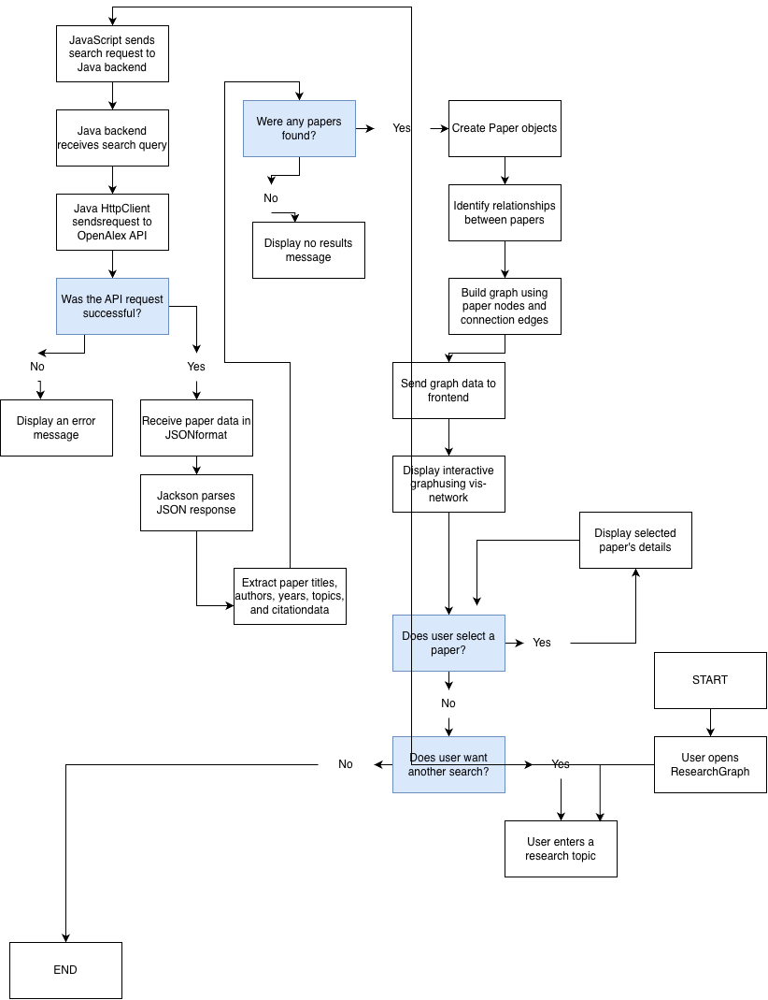

# CS193-project

# Researcher

## Project Goal
It is an interactive web platform designed to help students and researchers visually explore connections between academic papers, authors, and research topics using graph data structures.

## System Diagram

## Design Documents
- [Eisenhower Matrix (PDF)](EisenhowerMatrix.pdf)

## MVP Scope
Academic Paper Search: Search for research papers by entering a topic or keyword.
Paper Information: View paper titles, authors, publication years, and available abstracts.
Research Connections: Identify relationships between papers based on shared authors, topics, and citations.
Interactive Network Graph: Visualize papers as nodes and their relationships as connecting edges.
Paper Exploration: Select individual nodes to view additional information about a paper.

## Tech Stack
- Java 25
- HTML
- CSS
- JavaScript
- Java HttpClient
- Jackson
- Java HttpServer
- vis-network
- OpenAlex API
- Git and GitHub

## Schedule & Future Plans
Future improvements include:
- Adding filters for publication year and research topics.
- Allowing users to save papers and organize them into collections.
- Implementing advanced graph exploration to discover multiple levels of connections.
- Comparing research trends across different years.
- Adding user accounts and personalized paper recommendations.
